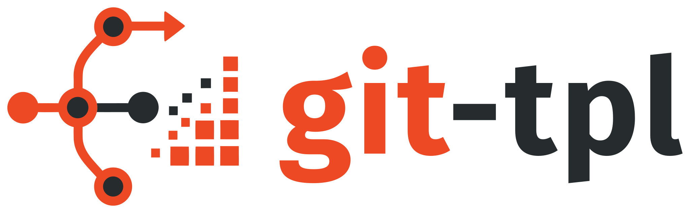
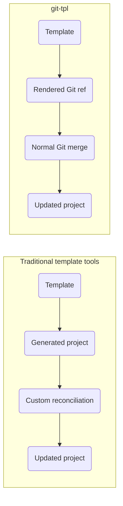
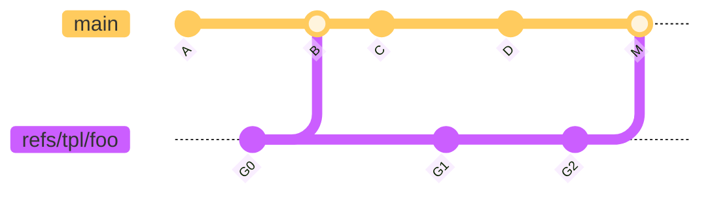

<p align="center">
  
</p>

<p align="center"><strong>Git-native project templates</strong></p>

<p align="center">
  <a href="https://github.com/noirbizarre/git-tpl/actions/workflows/ci.yaml">
    
  </a>
  <a href="https://codecov.io/gh/noirbizarre/git-tpl">
    
  </a>
  <a href="https://crates.io/crates/git-tpl"></a>
  
  <a href="https://noirbizarre.github.io/git-tpl/">
    
  </a>
  
</p>

---

git-tpl renders a template into a dedicated Git ref. Updating the template
advances that ref. You incorporate the changes with a normal `git merge`.

That is the whole idea. There is no reconciliation algorithm, no patch replay,
no conflict resolver — Git already has all of those, and they are better than
anything a template tool would write.



## Install

```sh
brew install noirbizarre/tap/git-tpl   # or: cargo install git-tpl
```

Also on the AUR, from a release archive, and via mise —
[Installation](https://noirbizarre.github.io/git-tpl/getting-started/installation/) has
all of them. Homebrew and AUR packages install the man page and completions;
release archives contain them for manual installation.
`cargo install` and `cargo binstall` place only the binary, so `git tpl --help`
reports *No manual entry for git-tpl* until you generate and install the man page.
Mise's cargo backend has the same binary-only behavior.
Use `git tpl help` or `git tpl help <command>` for built-in help without man pages.

The binary must be named `git-tpl` and be on your `PATH` — that is how Git
resolves `git tpl`.

In GitHub Actions, install it for subsequent steps:

```yaml
steps:
  - uses: actions/checkout@v7
  - uses: noirbizarre/git-tpl@main
    with:
      version: 0.14.3 # omit to install the latest release
  - run: git tpl --version
```

See [Installation](https://noirbizarre.github.io/git-tpl/getting-started/installation/#in-github-actions)
for supported runners and version pinning.

## Use

```sh
cd my-project
git tpl init https://github.com/noirbizarre/rust-library-template
```

That works on an empty repository and on a project that already has files. On an
existing project the merge reconciles the two sides: files identical to the
rendered ones merge silently, files you have edited conflict only on the lines
that differ, and files the template adds are staged for you. Resolve as you
would any merge.

Later, when the template moves on:

```sh
git tpl status   # has the template changed?
git tpl update   # advance refs/tpl/<id> — rendered files are not applied
git tpl diff     # what would change
git tpl merge    # take it
```

`update` leaves `HEAD`, the index, and rendered worktree files untouched.
Changed answers or composed child locks can update `.config/git.tpl.toml` as an unstaged edit.

Have an agent do this for you? See the [AI agent skill](https://noirbizarre.github.io/git-tpl/usage/skill/) —
`skills/git-tpl/SKILL.md` in this repository.

## The model



`G0`, `G1`, `G2` are successive rendered states of the template. `M` is a merge
you ran. Every Git command works on the ref:

```sh
git show refs/tpl/github-com-noirbizarre-rust-library-template
git log  refs/tpl/github-com-noirbizarre-rust-library-template
git diff HEAD refs/tpl/github-com-noirbizarre-rust-library-template
git merge refs/tpl/github-com-noirbizarre-rust-library-template
```

**`git tpl update` never changes `HEAD`, the index, or rendered files in your worktree.**
It writes a Git tree directly and moves one ref. When answers change, it also records them in
`.config/git.tpl.toml` as an unstaged worktree edit.

**Template refs are not pushed by default.** Ordinary `git push` and `git pull`
ignore `refs/tpl/*`; `git tpl push` and `git tpl fetch` are explicit, while
`tpl.autoPush` or `git tpl update --push` opts into pushing after an update. A
contributor who clones the project and never runs git-tpl is unaffected by its
existence.

## Templates

A template is a normal Git repository with a `template.toml`:

```toml
name = "rust-library"

[questions.project_name]
type = "string"
prompt = "Project name"

[questions.project_type]
type = "choice"
prompt = "Project type"
choices = ["library", "application"]

[questions.cli]
type = "boolean"
prompt = "Create a CLI?"
when = "{{ project_type == 'application' }}"

[computed]
package_name = "{{ project_name | lower | replace(' ', '-') }}"
```

Rendering is [MiniJinja](https://docs.rs/minijinja), and only MiniJinja.
Templates cannot execute code — no hooks, no scripts, no embedded interpreter.

**[Browse templates on GitHub](https://github.com/search?q=topic%3Agit-tpl+topic%3Atemplate&type=repositories)**
— repositories tagged with both `git-tpl` and `template`.
Add both topics to reusable template repositories you publish on GitHub;
see [Publishing](https://noirbizarre.github.io/git-tpl/templates/format/#publishing) for UI and CLI instructions.
Topics are a discovery convention, not a registry or runtime lookup: `git tpl init` still takes a Git URL.

## Documentation

**[noirbizarre.github.io/git-tpl](https://noirbizarre.github.io/git-tpl/)**

- [The Git model](https://noirbizarre.github.io/git-tpl/concepts/git-model/) — start here
- [Quick start](https://noirbizarre.github.io/git-tpl/getting-started/quickstart/)
- [Template format](https://noirbizarre.github.io/git-tpl/templates/format/)
- [Architecture decisions](https://noirbizarre.github.io/git-tpl/adr/)

## Status

Early. The core model works end to end; the documentation describes what is
implemented, and the [issue tracker](https://github.com/noirbizarre/git-tpl/issues)
holds what is not. See the
[roadmap](https://noirbizarre.github.io/git-tpl/development/roadmap/) for how it
is organised.

## License

MIT
