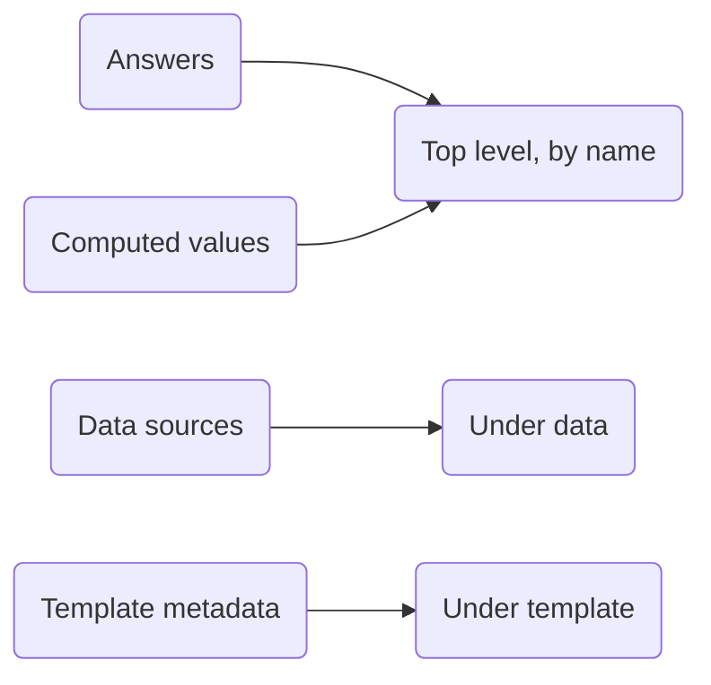
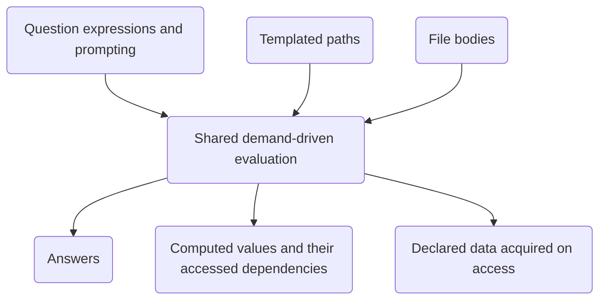

# Template context

One context serves both the question engine and the renderer.
A value resolved while prompting is the same value the template sees.

## Shape



```jinja
{{ project_name }}          {# an answer #}
{{ package_name }}          {# a computed value #}
{{ data.licenses.mit.spdx }} {# loaded data #}
{{ template.name }}          {# template metadata #}
```

### Why answers are at the top level

Because `{{ answers.project_name }}` is noise, and templates are read far more often than they are written.
The cost is that answers and computed values share one namespace — which is why a collision between them is
[an error](computed.md#names-must-not-collide) rather than a shadow.

`data` and `template` are namespaced because they are structured and are not what a template reaches for most of
the time.

## `template`

| Name | Type |
|---|---|
| `template.name` | string |
| `template.description` | string or undefined |

Deliberately minimal.
The template's *revision* is not here: a template that rendered its own commit SHA into a file would produce a
different tree on every template commit, which is exactly the non-determinism this design avoids.
The revision is recorded in the commit trailers instead, where it belongs.

## `data`

Whatever the data sources parsed to, as structured values — tables stay tables, arrays stay arrays, numbers stay
numbers.
See [Data sources](../data/index.md).

## Null and absence

JSON/YAML null and a whole expression returning `none` preserve an explicit null value, including inside containers.
Null is defined and falsy; it is distinct from a missing name, false, zero and an empty string.
Use `value is defined` for presence and `value is none` for null.
The JSON context dump retains null-valued members and omits missing names.

This changes older null-to-empty-string normalization.
If a template needs empty text for null, choose it explicitly, for example `{{ value if value is not none else '' }}`.
Undefined expression results retain their existing lenient empty-string conversion; undefined is not null.
Question types remain non-nullable, and TOML has no native null literal.
See [context test assertions](../usage/test.md#context-assertions) and [ADR-048](../adr/048-context-assertions.md).

## How it is built



Questions, templated paths and file bodies share one evaluation session and its resolved values.
Computed values and declared data resolve only when an expression actually accesses them,
including dependencies reached through conditions and short-circuiting.
Rendering can therefore demand values that no question needed; unused values remain unresolved.
See [computed values](computed.md#available-while-prompting) and [data sources](../data/index.md).

## What is not in it

No environment variables.
No current time.
No Git user.
No repository metadata.
No process state.

This is [not an omission](../concepts/determinism.md#no-runtime-context).
A value that varies by machine belongs in the answers, where it is recorded and shared — not in the context,
where it is invisible and different for everyone.

The one place a machine fact is legible to a template is
[`default_from`](questions.md#machine-seeded-defaults), which reads its own small
[seed context](../adr/018-seed-context.md) — the Git configuration, the directory name, the remote,
[UTC datetime seeds](questions.md#datetime-seeds), and the [OS login name](questions.md#user-seeds).
That context is not this one, is reachable from nowhere else, and only ever pre-fills a prompt.
For example, `default_from = "{{ now.year }}"` suggests a copyright year that becomes an ordinary recorded answer.
Likewise, `default_from = "{{ user.name }}"` suggests the OS login name, independently of Git identity.
Ambient `now` and `user` values are still absent from rendered files and ordinary defaults.

## Imported names

A `` brings a [shared partial](format.md#shared-partials)'s macros into scope for the file that
imports it, and for that file only.
Nothing is implicitly available: a macro must be imported where it is used.

```jinja

{{ m.badge(project_name) }}
```

A partial is any `.jinja` file outside the rendered subdirectory, named by its path from the repository root.
It is read from the same pinned template revision as everything else — the loader cannot name a path on your
machine.

The same imports work in manifest expressions, so a `computed` value can use the macros a file uses.

## Filters and functions

MiniJinja's [built-in filters](https://docs.rs/minijinja/latest/minijinja/filters/index.html) are available:
`lower`, `upper`, `replace`, `trim`, `join`, `default`, `length`, `first`, `last`, `sort`, `map`, `select`,
`tojson`, and the rest.

No custom functions are registered.
Anything that would reach outside the context — reading a file, making a request, running a command — is not, and
will not be, available to expressions.
Fetching belongs to the [data-source subsystem](../data/index.md), which owns it explicitly.

### `slugify`

`slugify` is added to the built-ins because a real template cannot reasonably write it for itself:

```jinja
{{ project_name | slugify }}
```

It transliterates to ASCII, lowercases, and joins the remaining alphanumeric runs with a single `-`:

| Input | Result |
|---|---|
| `My Project` | `my-project` |
| `Hello, World!` | `hello-world` |
| `Café Déjà-Vu` | `cafe-deja-vu` |
| `Größe` | `grosse` |
| `Москва` | `moskva` |
| `北京` | `bei-jing` |

`lower | replace(' ', '-')` is the usual substitute and it is wrong twice: it leaves accents and punctuation in
the result, and it produces something that is not a valid module name, package name or path segment for anyone
whose project is not named in ASCII.

Input that slugs to nothing — `!!!`, or an empty string — yields an empty string rather than an error.
A filter that raised inside a `when` condition would abort the whole render; an empty value is visible
immediately.

The filter is available everywhere any other expression is: in a `default`, in a `when`, in a computed value, in
a file body, in a templated path, and in a [`default_from`](questions.md#machine-seeded-defaults) seed
expression — which is where `{{ remote.name | slugify }}` earns its keep.

### `yesno`

`yesno` returns the string `yes` for a truthy value and `no` otherwise:

```jinja
enabled = {{ enabled | yesno }}
```

It uses Jinja truthiness, not string parsing:

| Input | Result |
|---|---|
| `true`, a nonzero number | `yes` |
| `false`, `0`, `0.0`, `none` | `no` |
| An empty string, list or map | `no` |
| A nonempty string, list or map | `yes` |
| The strings `"false"` and `"0"` | `yes` |

An undefined value passed to `yesno` yields `no`, even in strict mode.
An invalid nested lookup can still fail before the filter receives a value.
Like `slugify`, the filter is available in expressions, rendered files, templated paths and seed expressions.

### Adding filters and globals

**The set of filters and globals is deliberately small and closed by review.**
There is no plugin point, and templates cannot register code.
Selected syntactic sugar such as `yesno` may be accepted even when an inline conditional could express it.
Contributions of filters or globals are not guaranteed acceptance: each addition is a compatibility surface
that cannot later be removed.
Custom filters must remain pure, deterministic, and reach nothing outside their arguments;
render-time globals must likewise stay within the supplied context.
See [ADR-058](../adr/058-reviewed-template-conveniences.md) for the policy.
